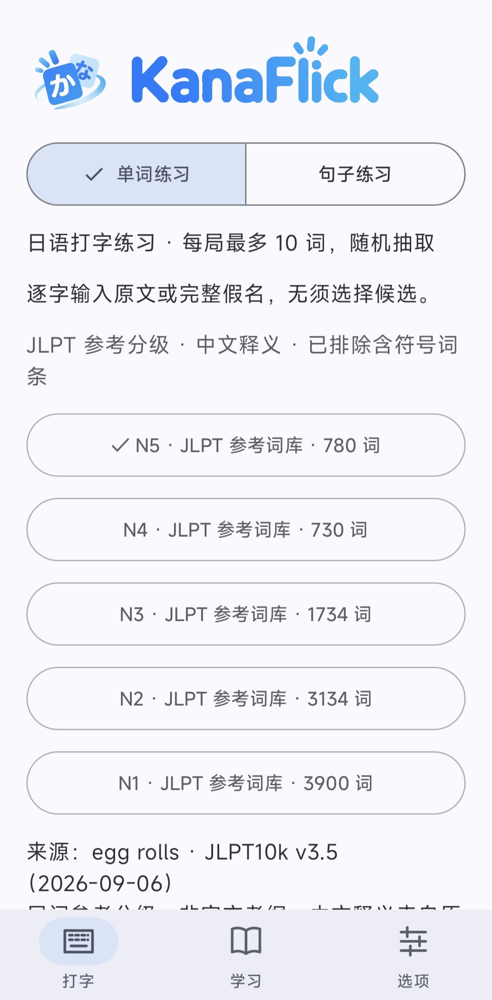
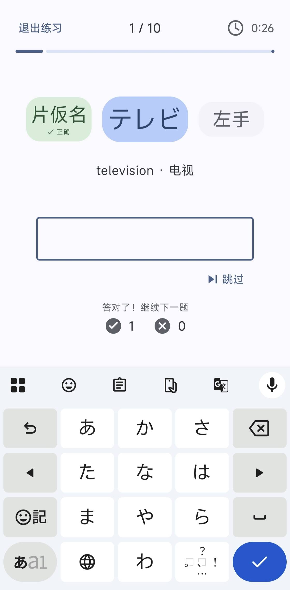
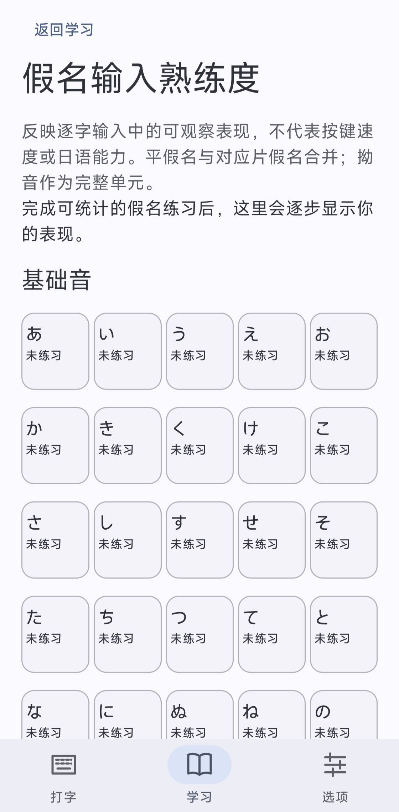
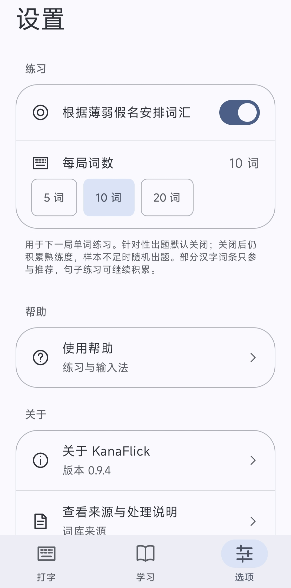

<p align="center">
  <picture>
    <source media="(prefers-color-scheme: dark)" srcset="docs/assets/banner-dark.svg">
    
  </picture>
</p>

<h1 align="center">かなフリック · KanaFlick</h1>

<p align="center">
  从一个词，到一句话。<br>
  用你熟悉的日语输入法，练习假名、词汇与阅读。
</p>

<p align="center">
  
  
  
  <a href="https://github.com/S-Hyakuri/KanaFlick/stargazers"></a>
</p>

<p align="center">
  <a href="#download">下载与安装</a> ·
  <a href="#features">功能介绍</a> ·
  <a href="#screenshots">界面预览</a> ·
  <a href="#quick-start">开始练习</a> ·
  <a href="CHANGELOG.md">更新日志</a> ·
  <a href="https://github.com/S-Hyakuri/KanaFlick/issues">反馈问题</a>
</p>

---

KanaFlick 是一款中文界面的 Android 日语打字与词汇学习应用。单词、句子与阅读内容均可离线使用，输入交给系统输入法；你可以按自己的习惯选择日语 12 键或 QWERTY 键盘。

> **当前为 0.9.4 开发版本。** 已有本地自动化验证，真实输入法、设备兼容性、视觉及性能验收仍未完成。具体结果见[验收记录](docs/acceptance.md)。

<a id="screenshots"></a>

## 界面预览

<p align="center">
  <a href="docs/assets/screenshots/home.jpg"></a>
  <a href="docs/assets/screenshots/word-practice.jpg"></a>
</p>
<p align="center"><sub>主页 · 单词练习</sub></p>

<p align="center">
  <a href="docs/assets/screenshots/proficiency.jpg"></a>
  <a href="docs/assets/screenshots/options.jpg"></a>
</p>

<p align="center"><sub>假名熟练度 · 选项<br>用户提供的浅色界面截图，点击可查看原图。键盘外观由系统输入法决定；截图中的针对性词汇已手动开启，应用默认关闭。</sub></p>

<a id="features"></a>

## 一点一点，练熟日语输入

| 功能 | 你可以做什么 |
| --- | --- |
| **单词练习** | 从 N5–N1 或自定义词库开始，每局选择 5、10 或 20 词，输入变化时实时判断，无须提交按钮。 |
| **句子练习** | 选择文章逐句练习，正确前缀显示进度，错误保留输入，方便继续修改。 |
| **离线阅读** | 浏览 25 篇、253 句日语内容，查看全文、假名及来源，再进入整篇练习。 |
| **假名熟练度** | 在五十音图中查看有效样本与近期错误倾向，了解哪些假名还需要练习。 |
| **针对性词汇** | 可选开启薄弱假名加权出题，保留随机探索，并遵循当前词库与等级范围。 |
| **自己的词库** | 添加、编辑词条，通过 CSV 导入或导出，练习自己需要的内容。 |

### 保留熟悉的输入方式

- **使用系统输入法**：不捆绑键盘，不绑定输入法品牌。
- **原文与完整假名均可作答**：例如题目为“学校”时，“学校”和“がっこう”均可完成；不推测任意汉字假名混写。
- **平片假名等价**：例如“コーヒー”也可以输入“こーひー”，保留长音符「ー」。
- **给转换过程留出空间**：正确前缀不计错，末尾浊点、小假名及罗马字转换中间态暂缓判断。

### 跟随系统，也照顾日常使用

采用 Jetpack Compose 与 Material 3。Android 12 及以上默认使用动态配色，Android 8–11 提供浅深主题回退，均跟随系统。学习列表按需加载，假名熟练度页面跨标签保留页面与滚动位置。

练习与画像数据保存在本机，不保存完整输入历史。核心练习无需联网，打开外部来源或仓库链接时需要网络。

<a id="download"></a>

## 下载与安装

**[前往 GitHub Releases →](https://github.com/S-Hyakuri/KanaFlick/releases)**

适用于 **Android 8.0（API 26）及以上**。在 Release 页面展开 **Assets**，选择发布者提供的 `.apk` 安装包。`Source code (zip)` 和 `Source code (tar.gz)` 是源码压缩包，不能直接安装到手机。

如果页面尚未提供 APK 附件，请先按下方说明从源码构建。预发布版本会标记为 **Pre-release**，请阅读对应的已知问题与测试范围。

> 卸载或清除应用数据会删除自定义词库、选项和熟练度。请先导出需要保留的自定义词库。开发版与发布版若签名不同，不能直接覆盖安装；不要为解决安装冲突直接清除数据。

<a id="quick-start"></a>

## 开始练习

1. 在系统中启用一个日语输入法，并选择自己习惯的键盘布局。
2. 首页选择 **单词练习** 或 **句子练习**，再选择等级、词库或文章。
3. 点击开始后输入答案，完整匹配会自动进入下一题，无须提交。
4. 遇到暂时不会的内容可以跳过；跳过单独计数，提前退出也能查看本局结算。

想了解自己的输入情况，可以从 **学习 → 假名输入熟练度** 查看。**选项 → 根据薄弱假名安排词汇** 默认关闭，开启后影响下一次从词库开始的单词抽样，不改变阅读文章顺序。

<details>
<summary><strong>输入判断与计分说明</strong></summary>

- 每次新文本变化触发判断，包括组合中的假名；完整答案可以直接推进，不要求先确认输入法候选。
- 正确前缀不计错；其他明确错误会反馈并保留输入，同一未修改错位不会重复罚分。
- 末尾浊点、小假名、罗马字转换中间态暂缓。例如“きや”可以继续改为“きゃ”，而“きやく”会按实际答案判断。
- 纯组合标记变化、光标移动、屏幕重建恢复，不会重复计分。
- 句子比较忽略标点和排版空白，保留助词标准书写与长音符「ー」。
- 跳过不增加正确或错误次数；零输入正确率为 0。句子正确率为完成句数 ÷（完成句数 + 错误次数）。
- 输入法候选栏由系统输入法管理，应用关闭候选建议的请求不保证被所有输入法采纳。
- 每局进入只自动请求一次键盘；主动收起后，可以点击输入框再次打开。计时在后台暂停，屏幕重建保留当前局。

</details>

<details>
<summary><strong>熟练度与本地数据说明</strong></summary>

熟练度与练习计分独立。只对能够可靠归因到假名的输入记录样本，不猜测汉字对应的按键过程，汉字完成不虚构成功样本。正确前缀、恢复文本及等待转换的末尾中间态不产生样本；每题同一假名单元最多一个样本。

少于 8 个样本时仅积累；达到 8 个且近期错误倾向不低于 0.30 时，才参与薄弱项加权。关闭针对性词汇仍会积累画像。确认重置只清除画像，不改变词库和练习选项。

画像保存在本机免备份目录，仅展示已成功持久化的汇总。突然终止时，未完成或未保存的题目可能不计入。词库及练习选项不参加系统备份，请使用 [CSV 导出](docs/csv-format.md)保留自定义词库。

</details>

## 从源码构建

使用 Android Studio 打开本仓库，配置 Android SDK 后同步项目。`local.properties` 中的 SDK 路径按本机环境设置，不提交到仓库。

| 项目 | 当前配置 |
| --- | --- |
| 界面 | Kotlin · Jetpack Compose · Material 3 |
| Android | minSdk 26 · compileSdk / targetSdk 37 |
| 构建工具 | AGP 9.4.1 · Gradle 9.6.0 · Kotlin Compose 2.2.10 |
| 本地已用构建环境 | Android Studio JBR / JDK 25 |

Windows PowerShell：

```powershell
.\gradlew.bat :app:testDebugUnitTest :app:lintDebug :app:assembleDebug
```

生成的开发安装包位于 `app/build/outputs/apk/debug/app-debug.apk`，使用开发签名。连接已授权 USB 调试的手机或启动模拟器后，可在 Android Studio 中运行；设备测试命令为：

```powershell
.\gradlew.bat :app:connectedDebugAndroidTest
```

<details>
<summary><strong>当前验证范围</strong></summary>

0.9.4 的现有记录：86 项单元测试通过；Lint 0 错误、18 警告；Debug 与设备测试包构建通过。这些结果来自已有[验证证据](docs/evidence/v0.9.4/verification.json)，本次 README 调整没有重新运行应用测试。

该轮没有连接设备，设备测试未执行，不能据此认定真实 IME、深浅主题、大字体、兼容性或性能已验收。详见[验收记录](docs/acceptance.md)。

</details>

## 内容来源与许可

感谢原作者及社区提供的词汇和阅读材料。**参考 JLPT 分级仅用于学习，不代表官方考纲或官方认证。**

| 内容 | 来源与许可说明 |
| --- | --- |
| JLPT 词库 | egg rolls 社区牌组，原始 10,635 词；练习与普通浏览排除含标点或特殊符号的词条后提供 10,278 词。数据采用 **CC BY-NC 4.0**，详见[词库来源](docs/vocabulary-sources.md)。 |
| 分级阅读 | 25 篇 / 253 句，N5–N1 各 5 篇。来源为たどくのひろば与日本語版ウィキペディア，逐篇保留署名、许可及改编说明，详见[阅读来源](docs/reading-sources.md)。 |
| 项目代码 | 当前尚未指定独立的代码许可证。公开源码不代表授予任意使用、修改和再分发的许可。 |

第三方材料继续适用各自许可，包括部分内容的非商业及相同方式共享要求；将来为项目代码添加许可证，也不替换这些材料的许可。

## 文档与反馈

| 想了解什么 | 入口 |
| --- | --- |
| 版本变化 | [更新日志](CHANGELOG.md) |
| 下一步计划 | [路线图](docs/roadmap-to-1.0.md) |
| 测过什么、还有哪些待验证 | [验收记录](docs/acceptance.md) |
| CSV 导入导出 | [格式说明](docs/csv-format.md) · [示例文件](docs/example-vocabulary.csv) |
| 界面与协作约定 | [设计规范](docs/design-system.md) · [AGENTS.md](AGENTS.md) |
| 如何生成安装包并发布 Release | [发布说明](docs/releasing.md) |

遇到问题或有建议，欢迎提交 [Issue](https://github.com/S-Hyakuri/KanaFlick/issues)。描述问题时，请附上应用版本、Android 版本、输入法名称及复现步骤；涉及界面的问题可以附截图。

<p align="center"><sub>フリックで、ことばが広がる。<br>Flick to a wider world.</sub></p>
